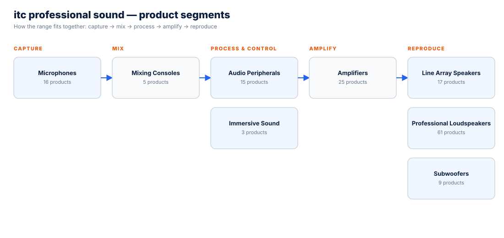

# itc Professional Sound — Product Catalogue

> Source: itcprosound.com (Guangzhou itc), scraped November 2026. Specifications as published by the manufacturer; descriptions rewritten by AudioVisual Nepal. Confirm figures at quotation.

**Manufacturer:** Guangzhou itc Professional Sound — HQ: Building A13-1, Yiku Industrial Park, Panyu District, Guangzhou, China · Factory: No.56 Nanlidong Road, Shiqi, Panyu · OEM/ODM manufacturer with 30+ years of experience; products listed in the EASE / EASE Focus libraries.

## Segment overview

| AVN category | itc series | Products |
|---|---|---|
| Amplifiers | DSP Series Amplifiers, Dante Network Amplifiers, KT Series Amplifiers, TC Series Amplifiers | 25 |
| Line Array Speakers | Line Array Speakers | 17 |
| Professional Loudspeakers | Cinema Loudspeakers, Conference & Column Loudspeakers, Multifunction Loudspeakers, Outdoor Loudspeakers, Stadium Horn Speakers, Stage Monitors | 61 |
| Subwoofers | Subwoofers | 9 |
| Mixing Consoles | Analog Mixers with DSP, Digital Mixers | 5 |
| Microphones | Wired Microphones, Wireless Microphones | 16 |
| Immersive Sound | Immersive Sound System | 3 |
| Audio Peripherals | Audio Peripherals | 15 |

**Total:** 151 product pages.

## Core technology

- **Amplifiers:** AVMF (adaptive variable modulation frequency), MPAL (multi-track precise audio loop adjustment), ADPEC (adaptive dynamic power-efficient conversion); DSP + FIR processing; >95% efficiency on the TC Series; full protection (DC, short, overload, overheat).
- **Loudspeakers:** neodymium drivers, low-distortion waveguides, built-in DSP on active models, precise crossovers; models included in EASE / EASE Focus for acoustic simulation.
- **Ease Immersive:** object-based spatial audio (WFS) with real-time positioning, >90% sweet-spot coverage, PSN / Art-Net tracking for lighting follow.

## Amplifiers (25)

### DSP Series Amplifiers

| Model | Type | Key figures | Page |
|---|---|---|---|
| TC-2200B | 2 Channel Professional Amplifier | Output power: Stereo@8Ω: 200W×2 Stereo@4Ω: 400W×2; Frequency response: 20Hz-20KHz/±1dB @8Ω; THD+N: ≤0.01% | [view](https://www.audiovisualnepal.com/products/amplifiers/itc-tc-2200b) |
| T-2150KS | Multimedia Amplifier | Rated output power: 2x150W@4R; 2x95W@8R; Power voltage: ~220V 50Hz; Power loss: 100W | [view](https://www.audiovisualnepal.com/products/amplifiers/itc-t-2150ks) |
| T-2240K | Multimedia Amplifier | Rated power: 2×240W; Power voltage: ~220V/50Hz; Power consumption: 800W | [view](https://www.audiovisualnepal.com/products/amplifiers/itc-t-2240k) |
| T-2240KS | Multimedia Amplifier | Rated output power: 2x240W@4R; 2x120W@8R; Power voltage: ~220V 50Hz; Power consumption: 120W | [view](https://www.audiovisualnepal.com/products/amplifiers/itc-t-2240ks) |
| T-2350KS | Multimedia Amplifier | Rated output power: 2x350W@4R; 2x180W@8R; Power voltage: ~220V 50Hz; Power consumption: 150W | [view](https://www.audiovisualnepal.com/products/amplifiers/itc-t-2350ks) |
| T-2500KS | Multimedia Amplifier | Rated output power: 2x500W@4R; 2x350W@8R; Power voltage: ~220V 50Hz; Power consumption: 210W | [view](https://www.audiovisualnepal.com/products/amplifiers/itc-t-2500ks) |
| TC-D4200/TC-D4350/TC-D4500 | Four-Channel DSP Digital Amplifier | Frequency response: 20Hz-20kHz /+1/-1dB; THD+N: ≤0.05％; Power supply: ~ 220V  50Hz | [view](https://www.audiovisualnepal.com/products/amplifiers/itc-tc-d4200) |

### Dante Network Amplifiers

| Model | Type | Key figures | Page |
|---|---|---|---|
| TC-4500DT/TC-4700DT/TC-41500DT | Digital Amplifier | Frequency response: 20Hz-20kHz /+1/-1dB; THD+N: ≤0.05％; Power supply: ~ 220V  50Hz | [view](https://www.audiovisualnepal.com/products/amplifiers/itc-tc-4500dt) |

### KT Series Amplifiers

| Model | Type | Key figures | Page |
|---|---|---|---|
| KT-P21000 | Professional Digital Amplifier | Output power: Continuous power amplification; Frequency response: 20Hz~20kHz/+3~-1dB; THD+N: ≤0.01% | [view](https://www.audiovisualnepal.com/products/amplifiers/itc-kt-p21000) |
| KT-P21200 | Professional Digital Amplifier | Output power: Continuous power amplification; Frequency response: 20Hz~20kHz/+3~-1dB; THD+N: ≤0.01% | [view](https://www.audiovisualnepal.com/products/amplifiers/itc-kt-p21200) |

### TC Series Amplifiers

| Model | Type | Key figures | Page |
|---|---|---|---|
| TC-2200B | Professional Amplifier | Output power: Stereo@8Ω: 200W×2 Stereo@4Ω: 400W×2; Frequency response: 20Hz-20KHz/±1dB @8Ω; THD+N: ≤0.01% | [view](https://www.audiovisualnepal.com/products/amplifiers/itc-tc-2200b-2) |
| TC-2350B | Professional Amplifier | Output power: Stereo@8Ω: 350W×2 Stereo@4Ω: 600W×2; Frequency response: 20Hz-20KHz/±1dB @8Ω; THD+N: ≤0.01% | [view](https://www.audiovisualnepal.com/products/amplifiers/itc-tc-2350b) |
| TC-2500 | Professional Amplifier | Output power: Stereo 8Ω: 2*500W; 4Ω: 2*800W; 2Ω: 2*1300W; Bridge 16Ω: 1000W; 8Ω: 1600W; 4Ω: 2600W;; Frequency response: 20-20KHz/±1dB; THD+N: ≤0.01% | [view](https://www.audiovisualnepal.com/products/amplifiers/itc-tc-2500) |
| TC-2500B | Professional Amplifier | Output power: Stereo@8Ω: 500W×2 Stereo@4Ω: 850W×2 Bridged @8Ω: 1700W; Frequency response: 20Hz-20KHz/±1dB @8Ω; THD+N: ≤0.01% | [view](https://www.audiovisualnepal.com/products/amplifiers/itc-tc-2500b) |
| TC-2700 | Professional Amplifier | Frequency response: 20-20KHz/±1dB; THD+N: ≤0.01%; Power supply: ~ 220 50Hz | [view](https://www.audiovisualnepal.com/products/amplifiers/itc-tc-2700) |
| TC-2700B | Professional Amplifier | Output power: Stereo @8Ω: 700W×2 Stereo @4Ω: 1000W×2 Bridge @16Ω: 1400W Bridge @8Ω: 2000W; Frequency response: 20Hz-20KHz/±1dB@8Ω; THD+N: ≤0.01% | [view](https://www.audiovisualnepal.com/products/amplifiers/itc-tc-2700b) |
| TC-4200B | Professional Amplifier | Output power: Stereo 8Ω: 200W×4 Stereo 4Ω: 380W×4 Bridge 8Ω: 760W; Frequency response: 20Hz-20KHz/±1dB @8Ω; THD+N: ≤0.01% | [view](https://www.audiovisualnepal.com/products/amplifiers/itc-tc-4200b) |
| TC-4350B | Professional Amplifier | Output power: Stereo 8Ω: 350W×4 Stereo 4Ω: 580W×4 Bridge 8Ω: 1100W; Frequency response: 20Hz-20KHz/±1dB @8Ω; THD+N: ≤0.01% | [view](https://www.audiovisualnepal.com/products/amplifiers/itc-tc-4350b) |
| TC-4500B | Professional Amplifier | Output power: Stereo 8Ω ：500W×4 Stereo 4Ω：850W×4 Bridge 8Ω：1700W; Frequency response: 20Hz-20KHz ±1dB @8Ω; THD+N: ≤0.01% | [view](https://www.audiovisualnepal.com/products/amplifiers/itc-tc-4500b) |
| TC-4700 | Professional Amplifier | Frequency response: 20-20KHz/±1dB; THD+N: ≤0.01%; Power supply: ~220 50Hz | [view](https://www.audiovisualnepal.com/products/amplifiers/itc-tc-4700) |
| TC-21000 | Professional Amplifier | Power: 2*1000W · 2*1500W; Power: 2*1700W · 2*2600W; Power: 2*2900W · 2*4350W | [view](https://www.audiovisualnepal.com/products/amplifiers/itc-tc-21000) |
| TC-41500 | Professional Amplifier | Input sensitivity(rated output power, @1KHz): 41dB，38dB，35dB，32dB，optional; Frequency response: 20-20KHz/±1dB; THD+N: ≤0.01％ | [view](https://www.audiovisualnepal.com/products/amplifiers/itc-tc-41500) |
| TC-21200 | Professional Amplifier | Power: 2*1200W · 2*2000W; Power: 2*1900W · 2*3400W; Power: 2*3200W · 2*4800W | [view](https://www.audiovisualnepal.com/products/amplifiers/itc-tc-21200) |
| TC-23000 | Professional Amplifier | Input sensitivity: 44dB, 41dB, 38dB, 35dB, optional; Frequency response: 20Hz-20KHz/±1dB; THD+N: ≤0.01％ | [view](https://www.audiovisualnepal.com/products/amplifiers/itc-tc-23000) |
| TC-4500 | Professional Amplifier | Output power: Stereo 8Ω: 4*500W; 4Ω: 4*800W; 2Ω: 4*1300W; Bridge 16Ω: 2*1000W; 8Ω: 2*1600W; 4Ω: 2*2600W; Frequency response: 20-20KHz/±1dB; THD+N: ≤0.01% | [view](https://www.audiovisualnepal.com/products/amplifiers/itc-tc-4500) |

## Line Array Speakers (17)

### Line Array Speakers

| Model | Type | Key figures | Page |
|---|---|---|---|
| KF-D212 | Linear Array Speaker | Rated power: Woofer: 800W, Tweeter: 160W; Peak power: Woofer: 3200W, Tweeter: 640W; Frequency range: 50Hz-20KHz | [view](https://www.audiovisualnepal.com/products/line-array-speakers/itc-kf-d212) |
| KF-D218S | Linear Array Subwoofer | Rated power: 1600W; Peak power: 6400W; Frequency range: 35Hz-200Hz | [view](https://www.audiovisualnepal.com/products/line-array-speakers/itc-kf-d218s) |
| KH-118 | Linear Array Subwoofer | Rated power: 800W; Peak power: 3200W; Frequency range: 50Hz- 400Hz | [view](https://www.audiovisualnepal.com/products/line-array-speakers/itc-kh-118) |
| KH-208 | Linear Array Speaker | Rated power: 600W; Peak power: 2400W; Frequency range: 5 0Hz-20KHz | [view](https://www.audiovisualnepal.com/products/line-array-speakers/itc-kh-208) |
| KS-210 | Linear Array Full Range Speaker | Rated power: LF: 700W, HF: 400W; Peak power: LF: 2800W, HF:1 600W; Frequency range: 50Hz-20KHz | [view](https://www.audiovisualnepal.com/products/line-array-speakers/itc-ks-210) |
| KS-S218 | Linear Array Subwoofer | Rated power: 1600W; Peak power: 6400W; Frequency range: 28Hz-150Hz | [view](https://www.audiovisualnepal.com/products/line-array-speakers/itc-ks-s218) |
| LA-112H/LA-118H | Linear Array Speaker | Rated power: 400W / 600W; Peak power: 1600W / 2400W; Frequency range: 55Hz-20KHz / 40Hz-400KHz | [view](https://www.audiovisualnepal.com/products/line-array-speakers/itc-la-112h) |
| LA-2100/LA-1180 | Linear Array Speaker | Rated power: 600W (AES) / 800W (AES); Peak power: 2400W / 3200W; Frequency range: 65Hz~20KHz / 40Hz~400Hz | [view](https://www.audiovisualnepal.com/products/line-array-speakers/itc-la-2100) |
| LA-2100K/LA-1180K | Linear Array Speaker | Rated power: 700W(AES) / 800W(AES); Peak power: 2800W / 3200W; Frequency range: 60Hz-20KHz / 40Hz-400Hz | [view](https://www.audiovisualnepal.com/products/line-array-speakers/itc-la-2100k) |
| LA-2100KW/LA-1180KW | Linear Array Speaker | Rated power: 700W(AES) / 800W(AES); Peak power: 2800W / 3200W; Frequency range: 60Hz-20KHz / 40Hz-400Hz | [view](https://www.audiovisualnepal.com/products/line-array-speakers/itc-la-2100kw) |
| LA-2120/LA-2180 | Linear Array Speaker | Rated power: 800W / 1200W; Peak power: 3200W / 4800W; Frequency range: 55Hz-20KHz / 40Hz-400KHz | [view](https://www.audiovisualnepal.com/products/line-array-speakers/itc-la-2120) |
| LA-2650/LA-1200 | Linear Array Speaker | Rated power: 150W (AES) / 350W(AES); Power supply: AC~ 220V/50Hz, power consumption 120W / AC~ 220V/50Hz, power consumption 280W; Frequency range: 85Hz~20KHz / 40Hz-400Hz | [view](https://www.audiovisualnepal.com/products/line-array-speakers/itc-la-2650) |
| LA-2800/LA-1800 | Linear Array Speaker | Rated power: 500W(AES) / 600W(AES); Peak power: 2000W / 2400W; Frequency range: 70Hz-20kHz / 40Hz-400Hz | [view](https://www.audiovisualnepal.com/products/line-array-speakers/itc-la-2800) |
| LA-2800K/LA-1800K | Linear Array Speaker | Rated power: 600W (AES) / 800W (AES); Peak power: 2400W; Frequency range: 65Hz-20KHz / 40Hz-400Hz | [view](https://www.audiovisualnepal.com/products/line-array-speakers/itc-la-2800k) |
| TK-L205/TK-S125 | Line Array Speaker | Rated power: 200W; Peak power: 800W; Frequency range: 65Hz-20KHz | [view](https://www.audiovisualnepal.com/products/line-array-speakers/itc-tk-l205) |
| TK-L210 | Linear Array Speaker | Rated power: Woofer 500W, tweeter 80W; Peak power: Woofer 2000W, tweeter 320W; Frequency range: 60Hz-20kHz | [view](https://www.audiovisualnepal.com/products/line-array-speakers/itc-tk-l210) |
| TK-S180 | Linear Array Speaker | Rated power: 800W; Peak power: 3200W; Frequency range: 35Hz-250Hz | [view](https://www.audiovisualnepal.com/products/line-array-speakers/itc-tk-s180) |

## Professional Loudspeakers (61)

### Cinema Loudspeakers

| Model | Type | Key figures | Page |
|---|---|---|---|
| KF-Y10 | Professional Full Range Speaker | Rated power: 250W; Peak power: 1000W; Frequency range: 65Hz-18.5KHz | [view](https://www.audiovisualnepal.com/products/pro-loudspeakers/itc-kf-y10) |
| KF-Y12 | Professional Full Range Speaker | Rated power: 350W; Peak power: 1400W; Frequency range: 40Hz -19KHz | [view](https://www.audiovisualnepal.com/products/pro-loudspeakers/itc-kf-y12) |
| KF-Y15 | Professional Full Range Speaker | Rated power: 450W; Peak power: 1800W; Frequency range: 55Hz-18KHz | [view](https://www.audiovisualnepal.com/products/pro-loudspeakers/itc-kf-y15) |
| KF-Y215 | Professional Full Range Speaker | Rated power: 900W; Peak power: 3600W; Frequency range: 40Hz-18.5KHz | [view](https://www.audiovisualnepal.com/products/pro-loudspeakers/itc-kf-y215) |

### Conference & Column Loudspeakers

| Model | Type | Key figures | Page |
|---|---|---|---|
| TS-403C/TS-603C/TS-803C/TS-1203C | Professional Speaker | Rated power: 100W / 200W / 300W / 400W; Peak power: 200W / 800W / 1200W / 1600W; Frequency range: 80Hz-20kHz / 80Hz-20kHz / 70Hz-20kHz / 60Hz-20kHz | [view](https://www.audiovisualnepal.com/products/pro-loudspeakers/itc-ts-403c) |
| TS-605T | Wall-mounted Speaker | Rated power: 100W; Peak power: 400W; Frequency response: 80Hz-20kHz | [view](https://www.audiovisualnepal.com/products/pro-loudspeakers/itc-ts-605t) |
| TS-605TB | Wall-mounted Speaker | Rated power: 100W; Peak power: 400W; Frequency response: 80Hz-20kHz | [view](https://www.audiovisualnepal.com/products/pro-loudspeakers/itc-ts-605tb) |
| TS-774SR/TS-775SR/TS-776SR | Professional Speaker | Rated power: 30W / 50W / 60W; Frequency response: 80-20KHz / 80-20KHz / 60-20KHz; Sensitivity: 89dB / 90dB / 92dB | [view](https://www.audiovisualnepal.com/products/pro-loudspeakers/itc-ts-774sr) |
| TS-605Y | Wall-mounted Speaker | Rated power: 100W; Peak power: 400W; Frequency response: 80Hz-20kHz | [view](https://www.audiovisualnepal.com/products/pro-loudspeakers/itc-ts-605y) |
| TS-605YB | Wall-mounted Speaker | Rated power: 100W; Peak power: 400W; Frequency response: 80Hz-20kHz | [view](https://www.audiovisualnepal.com/products/pro-loudspeakers/itc-ts-605yb) |
| TS-610P/TS-612P/TS-615P | Professional Speaker | Rated power: 300W / 350W / 450W; Peak power: 1200W / 1400W / 1800W; Power supply: AC 220V 50Hz | [view](https://www.audiovisualnepal.com/products/pro-loudspeakers/itc-ts-610p) |
| TS-608/TS-610/TS-612/TS-615 | Professional Speaker | Rated power: 200W / 300W; Rated power: 350W / 450W; Peak Power: 800W / 1200W | [view](https://www.audiovisualnepal.com/products/pro-loudspeakers/itc-ts-608) |
| TS-606H | Professional Speaker | Rated power: 120W; Peak power: 480W; Frequency response: 70Hz-20KHz | [view](https://www.audiovisualnepal.com/products/pro-loudspeakers/itc-ts-606h) |
| TS-606HW | Professional Speaker | Rated power: 120W; Peak power: 480W; Frequency response: 70Hz-20KHz | [view](https://www.audiovisualnepal.com/products/pro-loudspeakers/itc-ts-606hw) |
| TS-606M/TS-608M | Professional Speaker | Rated power: 120W / 200W; Peak power: 480W / 800W; Frequency response: 70Hz-20KHz / 65Hz-20KHz | [view](https://www.audiovisualnepal.com/products/pro-loudspeakers/itc-ts-606m) |
| TS-608A | Professional Speaker | Rated power: 150W; Peak power: 600W; Frequency response: 65Hz~20KHz | [view](https://www.audiovisualnepal.com/products/pro-loudspeakers/itc-ts-608a) |
| TS-608AW | Professional Speaker | Rated power: 150W; Peak power: 600W; Frequency response: 65Hz~20KHz | [view](https://www.audiovisualnepal.com/products/pro-loudspeakers/itc-ts-608aw) |
| TS-608H | Professional Speaker | Rated power: 150W; Peak power: 600W; Frequency response: 70Hz-20KHz | [view](https://www.audiovisualnepal.com/products/pro-loudspeakers/itc-ts-608h) |
| TS-610W | Professional Speaker | Rated power: 300W; Peak power: 1200W; Frequency response: 55Hz~20KHz | [view](https://www.audiovisualnepal.com/products/pro-loudspeakers/itc-ts-610w) |
| TS-612W | Professional Speaker | Rated power: 350W; Peak power: 1400W; Frequency response: 50Hz~20KHz | [view](https://www.audiovisualnepal.com/products/pro-loudspeakers/itc-ts-612w) |
| TS-615W | Professional Speaker | Rated power: 450W; Peak power: 1800; Frequency response: 45Hz~20KHz | [view](https://www.audiovisualnepal.com/products/pro-loudspeakers/itc-ts-615w) |
| TS-615H | Professional Speaker | Rated power: 650W; Peak power: 2600W; Frequency response: 45Hz~20KHz | [view](https://www.audiovisualnepal.com/products/pro-loudspeakers/itc-ts-615h) |
| TS-710H | Professional Speaker | Rated power: 300W; Peak power: 1200W; Frequency response: 45Hz-20KHz | [view](https://www.audiovisualnepal.com/products/pro-loudspeakers/itc-ts-710h) |
| TS-715H | Professional Speaker | Rated power: 500W; Peak power: 2000W; Frequency response: 40Hz-20KHz | [view](https://www.audiovisualnepal.com/products/pro-loudspeakers/itc-ts-715h) |
| TS-403HB | Column Speaker | Rated power: 100W; Frequency range: 150Hz-14KHz@-6dB/80Hz-20KHz@-10dB; Coverage angle: Vertical >20°, horizontal >120°@ (-6db) | [view](https://www.audiovisualnepal.com/products/pro-loudspeakers/itc-ts-403hb) |
| TS-403HW | Column Speaker | Rated power: 100W; Frequency range: 150Hz-14KHz@-6dB  / 80Hz-20KHz@-10dB; Coverage angle: Vertical >20°, horizontal >120°@ (-6db) | [view](https://www.audiovisualnepal.com/products/pro-loudspeakers/itc-ts-403hw) |
| TS-404HK | Professional Column Speaker | Rated power: 250W; Peak power: 1000W; Frequency range: 70HZ-20KHZ | [view](https://www.audiovisualnepal.com/products/pro-loudspeakers/itc-ts-404hk) |
| TS-405HB | Professional Column Speaker | Rated power: 300W (1200W, PEAK); Frequency response: 75Hz-20KHz; Maximum SPL: 128dB/W/m(133dB, PEAK) | [view](https://www.audiovisualnepal.com/products/pro-loudspeakers/itc-ts-405hb) |
| TS-603B | Linear Full Range Speaker | Rated power: 150W; Peak power: 600W; Frequency response: 80Hz-20kHz | [view](https://www.audiovisualnepal.com/products/pro-loudspeakers/itc-ts-603b) |
| TS-603C | Column Speaker | Rated power: 200W; Peak power: 800W; Frequency range: 80Hz-20kHz | [view](https://www.audiovisualnepal.com/products/pro-loudspeakers/itc-ts-603c) |
| TS-603H | Column Speaker | Rated power: 200W; Peak power: 800W; Frequency response: 80Hz-20KHz | [view](https://www.audiovisualnepal.com/products/pro-loudspeakers/itc-ts-603h) |

### Multifunction Loudspeakers

| Model | Type | Key figures | Page |
|---|---|---|---|
| KS-10H | Professional Full Range Speaker | Rated power: 600W; Peak power: 2400W; Frequency range: 55Hz -20KHz | [view](https://www.audiovisualnepal.com/products/pro-loudspeakers/itc-ks-10h) |
| TS-29B | Professional Speaker | Rated power: 250W; Frequency response: 45-20KHz; Coverage angle: (H) 45 ° (V) 90 ° | [view](https://www.audiovisualnepal.com/products/pro-loudspeakers/itc-ts-29b) |
| KF-606A2 | Professional Column Speaker | Rated power: 960W; Peak power: 3840W; Frequency range: 90Hz – 20KHz | [view](https://www.audiovisualnepal.com/products/pro-loudspeakers/itc-kf-606a2) |
| KF-D10F | Professional Speaker | Power: 350W; Peak power: 1400W; Frequency range: 55Hz-20kHz | [view](https://www.audiovisualnepal.com/products/pro-loudspeakers/itc-kf-d10f) |
| KF-D12F | Professional Speaker | Power: 450W; Peak power: 1800W; Frequency range: 50Hz-20kHz | [view](https://www.audiovisualnepal.com/products/pro-loudspeakers/itc-kf-d12f) |
| KF-D12H | Professional Speaker | Rated power: 500W; Peak power: 2000W; Frequency range: 55Hz-20kHz | [view](https://www.audiovisualnepal.com/products/pro-loudspeakers/itc-kf-d12h) |
| KF-D15F | Professional Speaker | Power: 550W; Peak power: 2200W; Frequency range: 45Hz-20kHz | [view](https://www.audiovisualnepal.com/products/pro-loudspeakers/itc-kf-d15f) |
| KF-D15H | Professional Speaker | Rated power: 600W; Peak power: 2400W; Frequency range: 50Hz-20kHz | [view](https://www.audiovisualnepal.com/products/pro-loudspeakers/itc-kf-d15h) |
| KS-12A35 | Portable Active Column Speaker | Rated power: 400W+400W; Peak power: 1600W+1600W; Crossover frequency: 4th/200Hz, DSP electronic frequency division | [view](https://www.audiovisualnepal.com/products/pro-loudspeakers/itc-ks-12a35) |
| KS-15A | Professional Speaker | Rated power: 500W; Peak power: 2000W; Frequency range（-10dB）: 45HZ-20KHZ | [view](https://www.audiovisualnepal.com/products/pro-loudspeakers/itc-ks-15a) |
| KS-206A | Professional Column Speaker | Rated power: 300W; Peak power: 1200W; Frequency range: 90HZ-20KHZ | [view](https://www.audiovisualnepal.com/products/pro-loudspeakers/itc-ks-206a) |
| KT-D12 | Professional Full-range Speaker | Rated power: 500W; Peak power: 2000W; Frequency range: 45Hz-20KHz | [view](https://www.audiovisualnepal.com/products/pro-loudspeakers/itc-kt-d12) |
| KT-H12 | Professional Full Range Speaker | Rated power: 500W; Peak power: 2000W; Frequency range: 4 5Hz-20KHz | [view](https://www.audiovisualnepal.com/products/pro-loudspeakers/itc-kt-h12) |
| KT-K12 | Professional Full Range Speaker | Rated power: 450W; Peak power: 1800W; Frequency range: 45Hz-20KHz | [view](https://www.audiovisualnepal.com/products/pro-loudspeakers/itc-kt-k12) |
| KT-M10 | Professional Full Range Speaker | Rated power: 300W; Peak power: 1200W; Frequency range: 60Hz-20KHz | [view](https://www.audiovisualnepal.com/products/pro-loudspeakers/itc-kt-m10) |
| KT-M12 | Professional Full Range Speaker | Rated power: 400W; Peak power: 1600W; Frequency range: 55Hz-20KHz | [view](https://www.audiovisualnepal.com/products/pro-loudspeakers/itc-kt-m12) |
| TK-M10 | Professional Speaker | Rated power: 300W; Peak power: 1200W; Frequency response: 45Hz-20kHz | [view](https://www.audiovisualnepal.com/products/pro-loudspeakers/itc-tk-m10) |
| TK-M12 | Professional Speaker | Rated power: 400W; Peak power: 1600W; Frequency response: 45Hz-20kHz | [view](https://www.audiovisualnepal.com/products/pro-loudspeakers/itc-tk-m12) |
| TK-M15 | Professional Speaker | Rated power: 500W; Peak power: 2000W; Frequency response: 40Hz-20kHz | [view](https://www.audiovisualnepal.com/products/pro-loudspeakers/itc-tk-m15) |
| TM-10H/TM-12H/TM-15H | Professional Speaker | Rated power: 500W; Peak power: 2000W; Frequency response: 40Hz-20kHz | [view](https://www.audiovisualnepal.com/products/pro-loudspeakers/itc-tm-10h) |
| KS-12A25 | Portable Active Column Speaker | Rated power: 400W+400W; Peak power: 1600W+1600W; Crossover frequency: 4th/200Hz, DSP electronic frequency division | [view](https://www.audiovisualnepal.com/products/pro-loudspeakers/itc-ks-12a25) |

### Outdoor Loudspeakers

| Model | Type | Key figures | Page |
|---|---|---|---|
| TS-108HT/TS-115HT | Outdoor Waterproof Speaker | Rated power: 37.5W/75W/150W @100V, 150W @8Ω optional / 75W/150W/300W @100V, 400W @8Ω optional; Peak power: 600W / 1200W; Frequency response: 75Hz-18kHz / 50Hz-18kHz | [view](https://www.audiovisualnepal.com/products/pro-loudspeakers/itc-ts-108ht) |
| TP-10 | Professional Speaker | Rated power: 250W; Peak power: 1000W; Frequency response: 60Hz-20KHz | [view](https://www.audiovisualnepal.com/products/pro-loudspeakers/itc-tp-10) |
| TP-12 | Professional Speaker | Rated power: 300W; Peak power: 1200W; Frequency response: 55Hz-20KHz | [view](https://www.audiovisualnepal.com/products/pro-loudspeakers/itc-tp-12) |
| TP-15 | Professional Speaker | Rated power: 400W; Peak power: 1600W; Frequency response: 50Hz-20KHz | [view](https://www.audiovisualnepal.com/products/pro-loudspeakers/itc-tp-15) |

### Stadium Horn Speakers

| Model | Type | Key figures | Page |
|---|---|---|---|
| TS-3H | Professional Speaker | Power: 400W; Frequency response: 100Hz~20KHz; Maximum SPL(±3dB): 124dB | [view](https://www.audiovisualnepal.com/products/pro-loudspeakers/itc-ts-3h) |

### Stage Monitors

| Model | Type | Key figures | Page |
|---|---|---|---|
| KS-14F | Professional Three-frequency Coaxial Monitor speaker | Rated power: 500W; Peak power: 2000W; Frequency range: 60Hz-20KHz | [view](https://www.audiovisualnepal.com/products/pro-loudspeakers/itc-ks-14f) |
| TK-T12 | Professional Speaker | Rated power: 400W; Peak power: 1600W; Frequency response: 50Hz-20kHz | [view](https://www.audiovisualnepal.com/products/pro-loudspeakers/itc-tk-t12) |
| TS-610T/TS-612T/TS-615T | Professional Speaker | Rated power: 300W / 400W / 500W; Peak power: 1200W / 1600W / 2000W; Frequency response: 60Hz-20KHz / 50Hz-20KHz / 45Hz-20KHz | [view](https://www.audiovisualnepal.com/products/pro-loudspeakers/itc-ts-610t) |
| TS-612TW | Professional Speaker | Rated power: 400W; Peak power: 1600W; Frequency response: 50Hz-20KHz | [view](https://www.audiovisualnepal.com/products/pro-loudspeakers/itc-ts-612tw) |

## Subwoofers (9)

### Subwoofers

| Model | Type | Key figures | Page |
|---|---|---|---|
| KF-YS18 | Subwoofer | Rated power: 800W; Peak power: 3200W; Frequency range: 42.5Hz-300Hz | [view](https://www.audiovisualnepal.com/products/subwoofers/itc-kf-ys18) |
| KF-YS218 | Professional Subwoofer Speaker | Power: 1600W; Frequency range: 33Hz-200KHz; Maximum SPL(rated/peak): 131dB/137dB | [view](https://www.audiovisualnepal.com/products/subwoofers/itc-kf-ys218) |
| KT-DS18 | Professional Subwoofer | Rated power: 800W; Peak power: 3200W; Frequency range: 3 5Hz-200Hz | [view](https://www.audiovisualnepal.com/products/subwoofers/itc-kt-ds18) |
| KT-DS218 | Professional Subwoofer | Rated power: 1600W; Peak power: 6400W; Frequency range: 35Hz-200Hz | [view](https://www.audiovisualnepal.com/products/subwoofers/itc-kt-ds218) |
| TS-112S | Professional Speaker | Rated power: 300W; Peak power: 1200W; Frequency response: 55Hz-400Hz | [view](https://www.audiovisualnepal.com/products/subwoofers/itc-ts-112s) |
| TS-615S | Professional Speaker | Rated power: 500W; Peak power: 2000W; Frequency response: 40Hz-400Hz | [view](https://www.audiovisualnepal.com/products/subwoofers/itc-ts-615s) |
| TS-618S | Professional Speaker | Rated power: 600W; Peak power: 2400W; Frequency response: 40Hz-400Hz | [view](https://www.audiovisualnepal.com/products/subwoofers/itc-ts-618s) |
| TS-628S | Professional Speaker | Rated power: 1200W; Peak power: 4800W; Frequency response: 40Hz-400Hz | [view](https://www.audiovisualnepal.com/products/subwoofers/itc-ts-628s) |
| TS-628SKW | Professional Speaker | Rated power: 1200W; Peak power: 4800W; Frequency response: 40Hz-400Hz | [view](https://www.audiovisualnepal.com/products/subwoofers/itc-ts-628skw) |

## Mixing Consoles (5)

### Analog Mixers with DSP

| Model | Type | Key figures | Page |
|---|---|---|---|
| TS-12PFX | Mixer | Phantom power: +48V with switch; Power supply: External AC18V/1A（AC 230-240V 50/60Hz）power adapter; Power consumption: ≤18W | [view](https://www.audiovisualnepal.com/products/mixing-consoles/itc-ts-12pfx) |
| TS-14PFX-4 | Mixer | Rated power: 30W; Phantom power: Each channel of CH1-CH6 has 48V phantom switch independent control; Frequency response: 20Hz-20kHz，±2dB | [view](https://www.audiovisualnepal.com/products/mixing-consoles/itc-ts-14pfx-4) |
| TS-16PFX-4 | Mixer | Rated power: 30W; Phantom power: Each channel of CH1-CH8 has 48V phantom switch independent control; Frequency response: 20Hz-20kHz，±2dB | [view](https://www.audiovisualnepal.com/products/mixing-consoles/itc-ts-16pfx-4) |

### Digital Mixers

| Model | Type | Key figures | Page |
|---|---|---|---|
| TS-24PD-12 | Digital Mixer | Power supply: AC 100v-240v; 50/60Hz 100W; Frequency response: 20Hz-20kHz ±0.3dB; Analog input: 24CH (MIC/Line) | [view](https://www.audiovisualnepal.com/products/mixing-consoles/itc-ts-24pd-12) |
| TS-32PD-12 | Digital Mixer | Power supply: AC 100v-240v; 50/60Hz 100W; Frequency response: 20Hz-20kHz ±0.3dB; Analog input: 32CH (MIC/Line) | [view](https://www.audiovisualnepal.com/products/mixing-consoles/itc-ts-32pd-12) |

## Microphones (16)

### Wired Microphones

| Model | Type | Key figures | Page |
|---|---|---|---|
| TS-331 | Wired Handheld Microphone | Frequency Response: 50Hz-15kHz; Sensitivity: (-49±2dB)(at  1KHz)(0dB=1V/Pa); Normal Impedance: 600Ω | [view](https://www.audiovisualnepal.com/products/microphones/itc-ts-331) |
| TS-301DM | Microphone | Power voltage: 48V Phantom power; Frequency response: 50Hz-18kHz; Sensitivity: -35dB | [view](https://www.audiovisualnepal.com/products/microphones/itc-ts-301dm) |
| TS-301DM2 | Microphone | Power voltage: Phantom power 48V; Frequency response: 60Hz-16kHz; Sensitivity: -35dB | [view](https://www.audiovisualnepal.com/products/microphones/itc-ts-301dm2) |
| TS-302DM | Microphone | Power voltage: 48V Phantom power; Frequency response: 50Hz-18kHz; Sensitivity: -35dB | [view](https://www.audiovisualnepal.com/products/microphones/itc-ts-302dm) |
| TS-304DM | Microphone | Power voltage: 48V Phantom power; Frequency response: 50Hz-18kHz; Sensitivity: -35dB | [view](https://www.audiovisualnepal.com/products/microphones/itc-ts-304dm) |
| TS-338 | Microphone | Power voltage: DC3V/phantom power 48V; Frequency response: 20Hz-18KHz; Sensitivity: -40dB±2dB | [view](https://www.audiovisualnepal.com/products/microphones/itc-ts-338) |

### Wireless Microphones

| Model | Type | Key figures | Page |
|---|---|---|---|
| T-540 | Microphone | Power supply: Phantom power 48V; Frequency response: 30Hz-16kHz; Sensitivity: -43dB±2dB | [view](https://www.audiovisualnepal.com/products/microphones/itc-t-540) |
| T-592UL | Wireless Microphone | Output power: ≥10dBm; Power supply: DC 12V/1A; Frequency r ange: 540MHz-590MHz、640MHz-690MHz | [view](https://www.audiovisualnepal.com/products/microphones/itc-t-592ul) |
| T-592UH | Wireless Microphone | Output power: ≥10dBm; Power supply: DC 12V/1A; Frequency range: 470-510MHz、540MHz-590MHz、640MHz-690MHz、807MHz-830MHz | [view](https://www.audiovisualnepal.com/products/microphones/itc-t-592uh) |
| T-592US | Wireless Microphone | Output power: ≥10dBm; Power supply: DC 12V/1A; Frequency range: 640MHz-690MHz | [view](https://www.audiovisualnepal.com/products/microphones/itc-t-592us) |
| T-592UT1 | Wireless Microphone | Output power: ≤200mA; Power supply: DC 12V/1A; Frequency range: 540MHz-590MHz、640MHz-690MHz | [view](https://www.audiovisualnepal.com/products/microphones/itc-t-592ut1) |
| T-592UT | Wireless Microphone | Output power: ≥10dBm; Power supply: DC 12V/1A; Frequency range: 470MHz-510MHz、540MHz-590MHz、640MHz-690MHz、807MHz-830MHz | [view](https://www.audiovisualnepal.com/products/microphones/itc-t-592ut) |
| T-592UV | Wireless Microphone | Output power: ≥10dBm; Power supply: DC 12V/1A; Frequency range: 470MHz-510MHz、540MHz-590MHz、640MHz-690MHz、807MHz-830MHz | [view](https://www.audiovisualnepal.com/products/microphones/itc-t-592uv) |
| T-592UW | Wireless Microphone | Output power: ≥10dBm; Power supply: DC 12V/1A; Frequency range: 640MHz-690MHz | [view](https://www.audiovisualnepal.com/products/microphones/itc-t-592uw) |
| TS-316M | Small Diaphragm Microphone | Phantom power: +48V; Power consumption: 3mA; Frequency response: 80Hz-20kHz | [view](https://www.audiovisualnepal.com/products/microphones/itc-ts-316m) |
| TS-548MD | Microphone | Power voltage: Phantom + 48V power supply; Frequency response: 40Hz-18kHz; Sensitivity: -45dB | [view](https://www.audiovisualnepal.com/products/microphones/itc-ts-548md) |

## Immersive Sound (3)

### Immersive Sound System

| Model | Type | Key figures | Page |
|---|---|---|---|
| TS-CJ00A | Immersive System Controller | Power supply: DC 12~24V; Maximum power consumption: 5W; Operating system: Ubuntu 18.04 LTS | [view](https://www.audiovisualnepal.com/products/immersive-sound/itc-ts-cj00a) |
| TS-CJ00G | Immersive System Management Controller | Power consumption: 65W; CPU: Intel Core i7-1165G7 (4-core 2.8GHz, maximum 4.7GHz); Graphics card: Intel Iris Xe Graphics | [view](https://www.audiovisualnepal.com/products/immersive-sound/itc-ts-cj00g) |
| TS-CJ00R | 3D Space Positioning System Software V3.074 |  | [view](https://www.audiovisualnepal.com/products/immersive-sound/itc-ts-cj00r) |

## Audio Peripherals (15)

### Audio Peripherals

| Model | Type | Key figures | Page |
|---|---|---|---|
| TS-18B | Desktop Socket | Power supply: AC 220V  50-60/HZ; Turn-up method: Air-supported pole; Overall weight: 1.5KG | [view](https://www.audiovisualnepal.com/products/audio-peripherals/itc-ts-18b) |
| TS-18C | Desktop Socket | Power supply: AC 220V  50-60/HZ; Pop-up method: Air-supported pole; Elevation angle: 45 degrees, fully accord with engineering principles | [view](https://www.audiovisualnepal.com/products/audio-peripherals/itc-ts-18c) |
| TS-18D | Desktop Socket | Power supply: AC 220V  50-60/HZ; Turn-up method: Air-supported pole; Overall weight: 1.5Kg | [view](https://www.audiovisualnepal.com/products/audio-peripherals/itc-ts-18d) |
| T-521CF | Charger | Input power: DC 12V / 1A; Battery: AA Ni-MH rechargeable battery; Charging method: Constant voltage PWM mode and trickle charging mode | [view](https://www.audiovisualnepal.com/products/audio-peripherals/itc-t-521cf) |
| T-522B | Microphone Antenna | Maximum power: 50W; Frequency range: 680~960MHz; Input impedance: 50Ω | [view](https://www.audiovisualnepal.com/products/audio-peripherals/itc-t-522b) |
| T-522S | Microphone Antenna | Half power lobe width: H:76°±5°, V:76°±5°; Maximum power: 50W; Frequency range: 550MHz～850MHz | [view](https://www.audiovisualnepal.com/products/audio-peripherals/itc-t-522s) |
| T-522A | Antenna Splitter | Power supply: 12V DC 3000mA; Distributed power output: 12V DC, total load of 4 receivers can not exceed 3A; Frequency band: 470-960MHz | [view](https://www.audiovisualnepal.com/products/audio-peripherals/itc-t-522a) |
| T-523A | Antenna Splitter | Power input: 12V DC 3000mA; Distribution power output: 12V DC, the load of 4 receivers cannot exceed 3A; Frequency range: Working frequency: all frequencies within 470-960M | [view](https://www.audiovisualnepal.com/products/audio-peripherals/itc-t-523a) |
| TK-200 | Microphone Desktop Stand | Height: 160-200mm; Weight: 0.23kg | [view](https://www.audiovisualnepal.com/products/audio-peripherals/itc-tk-200) |
| TK-300 | Microphone Floor Stand | Height: 980-1680mm; Slanting pole: 550-900mm; Weight: 1.5kg | [view](https://www.audiovisualnepal.com/products/audio-peripherals/itc-tk-300) |
| TS-224D | Suppressor | Frequency response: 20 Hz-20kHz (±0.5dB); Frequency resolution: 1Hz; Input channels and plugs: 2 XLR and TRS multi-use plug analog inputs | [view](https://www.audiovisualnepal.com/products/audio-peripherals/itc-ts-224d) |
| TS-224DX | Suppressor | Frequency response: 20Hz-20kHz（±0.5dB）; Frequency resolution: 1Hz; Input channels and plugs: 2 XLR and TRS multi-use plug analog inputs | [view](https://www.audiovisualnepal.com/products/audio-peripherals/itc-ts-224dx) |
| TS-3400MIX | Audio Processor | Main power supply: 100-240AC/50-60Hz; Static power consumption: 3.3W; Frequency response: 80Hz ~ 16kHz | [view](https://www.audiovisualnepal.com/products/audio-peripherals/itc-ts-3400mix) |
| TS-D1604 | Smart Mixer | Power supply: AC110V-240V; Power consumption: 20W; Frequency response: 20Hz-20kHz (±1dB) | [view](https://www.audiovisualnepal.com/products/audio-peripherals/itc-ts-d1604) |
| TS-D1604X | Smart Mixer | Power supply: AC110V-240V; Power consumption: 20W; Frequency response: 20Hz—20kHz（±1dB） | [view](https://www.audiovisualnepal.com/products/audio-peripherals/itc-ts-d1604x) |
