# itc Professional Sound — Venue Solutions

> Eight venue solutions. Each has an AVN system design (signal flow + plan-view coverage drawing) built from the itc range. Quantities are indicative and confirmed by survey.

## Stadium & Sports Ground

Reference room: 160 × 110 m

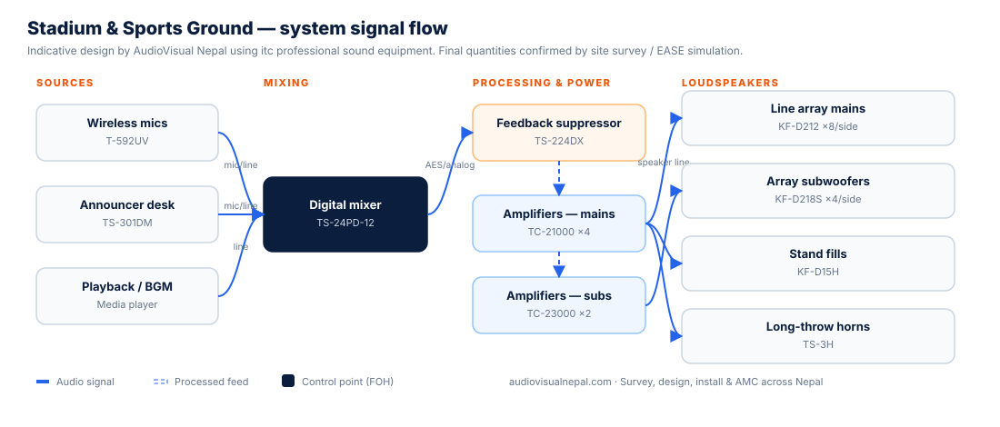

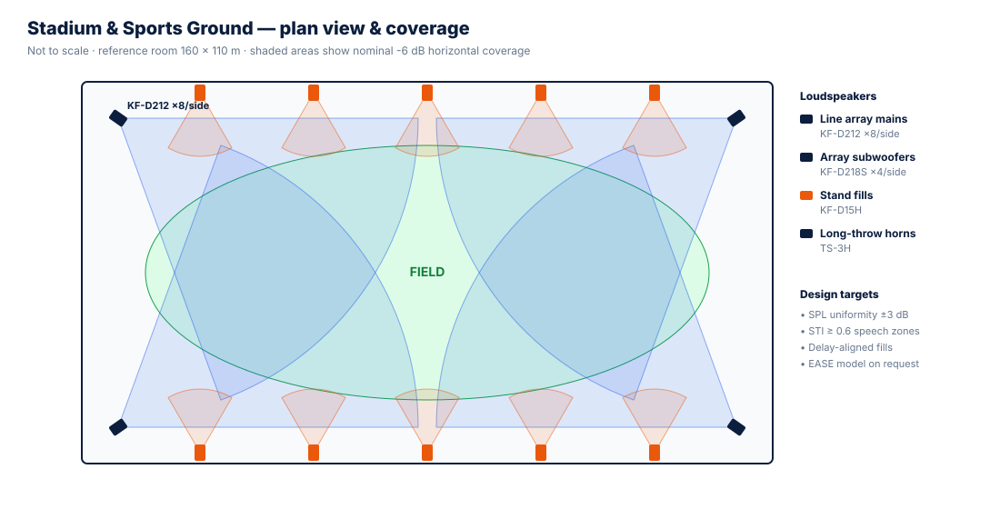

| Stage | Equipment | itc model |
|---|---|---|
| Source | Wireless mics | T-592UV |
| Source | Announcer desk | TS-301DM |
| Source | Playback / BGM | Media player |
| Mix | Digital mixer | TS-24PD-12 |
| Process | Feedback suppressor | TS-224DX |
| Power | Amplifiers — mains | TC-21000 ×4 |
| Power | Amplifiers — subs | TC-23000 ×2 |
| Loudspeakers | Line array mains | KF-D212 ×8/side |
| Loudspeakers | Array subwoofers | KF-D218S ×4/side |
| Loudspeakers | Stand fills | KF-D15H |
| Loudspeakers | Long-throw horns | TS-3H |

**System goals (manufacturer):**

- Employ linear array speaker with the characteristics of uniform horizontal coverage, strong vertical directivity, and small sound energy attenuation.
- Combine with subwoofers and monitor speakers to achieve perfect sound reinforcement.
- Meet the sound pressure requirements of the venue
- With waterproof functions to ensure normal operation in bad weather
- Can be flexibly disassembled, assembled, and moved
- The system responds quickly without excessive debugging
- Related Products

## Banquet Hall

Reference room: 40 × 25 m

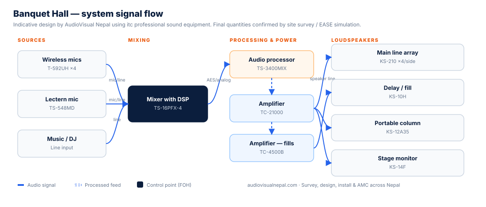

| Stage | Equipment | itc model |
|---|---|---|
| Source | Wireless mics | T-592UH ×4 |
| Source | Lectern mic | TS-548MD |
| Source | Music / DJ | Line input |
| Mix | Mixer with DSP | TS-16PFX-4 |
| Process | Audio processor | TS-3400MIX |
| Power | Amplifier | TC-21000 |
| Power | Amplifier — fills | TC-4500B |
| Loudspeakers | Main line array | KS-210 ×4/side |
| Loudspeakers | Delay / fill | KS-10H |
| Loudspeakers | Portable column | KS-12A35 |
| Loudspeakers | Stage monitor | KS-14F |

**System goals (manufacturer):**

- Improve language clarity and music intelligibility
- Expand the dynamic range when the source power is inadequate
- Possess good sound reproduction characteristics
- Play clear accompanying music
- Store preset operations to simplify technical operations
- Enable live program pickups and recordings

## Concert Hall

Reference room: 50 × 30 m

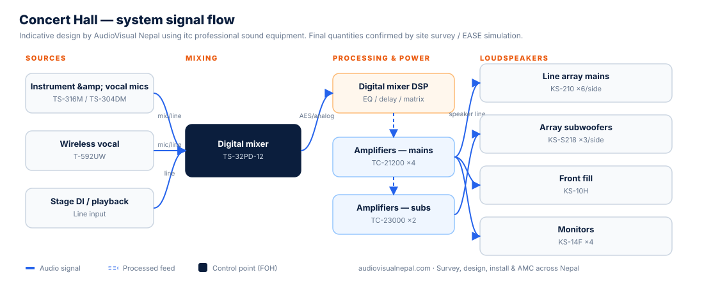

| Stage | Equipment | itc model |
|---|---|---|
| Source | Instrument & vocal mics | TS-316M / TS-304DM |
| Source | Wireless vocal | T-592UW |
| Source | Stage DI / playback | Line input |
| Mix | Digital mixer | TS-32PD-12 |
| Process | Digital mixer DSP | EQ / delay / matrix |
| Power | Amplifiers — mains | TC-21200 ×4 |
| Power | Amplifiers — subs | TC-23000 ×2 |
| Loudspeakers | Line array mains | KS-210 ×6/side |
| Loudspeakers | Array subwoofers | KS-S218 ×3/side |
| Loudspeakers | Front fill | KS-10H |
| Loudspeakers | Monitors | KS-14F ×4 |

**System goals (manufacturer):**

- Modify vocals and instrument sounds
- Improve speech clarity and music intelligibility
- Extend dynamic range
- Modify vocals and instrument sounds
- Enhance sound balance between different vocal parts (voice, music, and instrumental sound)
- Modify vocals and instrument sounds
- Maintain appropriate integration between visual and sound

## Conference Hall

Reference room: 30 × 20 m

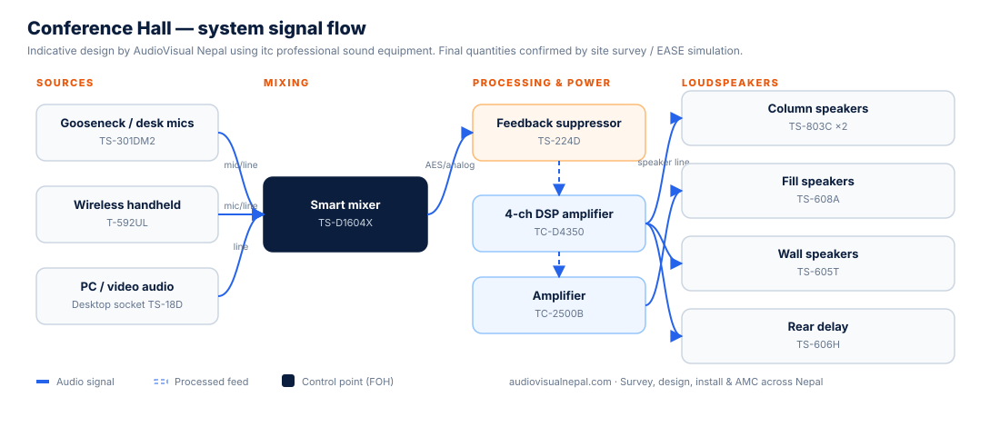

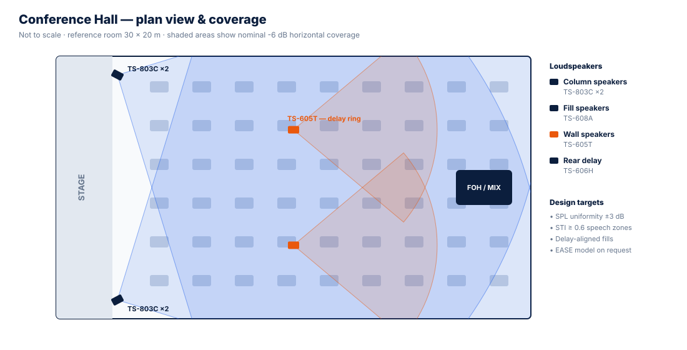

| Stage | Equipment | itc model |
|---|---|---|
| Source | Gooseneck / desk mics | TS-301DM2 |
| Source | Wireless handheld | T-592UL |
| Source | PC / video audio | Desktop socket TS-18D |
| Mix | Smart mixer | TS-D1604X |
| Process | Feedback suppressor | TS-224D |
| Power | 4-ch DSP amplifier | TC-D4350 |
| Power | Amplifier | TC-2500B |
| Loudspeakers | Column speakers | TS-803C ×2 |
| Loudspeakers | Fill speakers | TS-608A |
| Loudspeakers | Wall speakers | TS-605T |
| Loudspeakers | Rear delay | TS-606H |

**System goals (manufacturer):**

- Enable quick adjustments of preamp processors to meet different sound reinforcement modes
- Mixer with multi-group outputs for remote video conference audio signals and local conference audio signals
- Preset multiple venue effects and operating modes for direct use
- Employ full-range speakers to produce the best sound quality
- Store various effect modes for convenient and easy recall
- Allow for pre-setting and real-time adjustment through software based on the venue’s environment and speaker positioning

## KTV / Karaoke Room

Reference room: 6 × 5 m

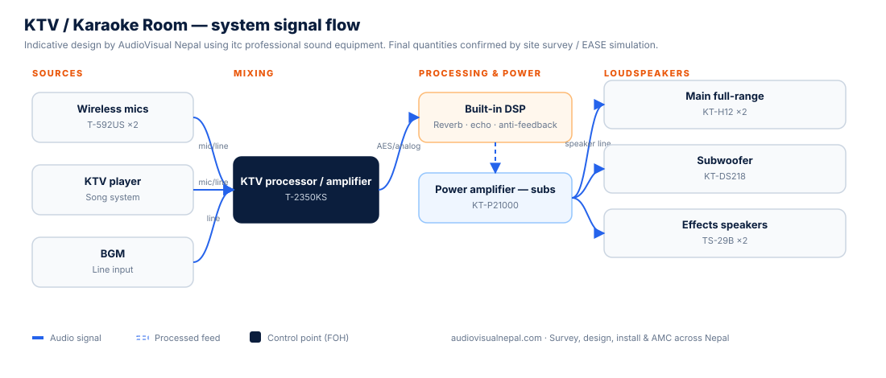

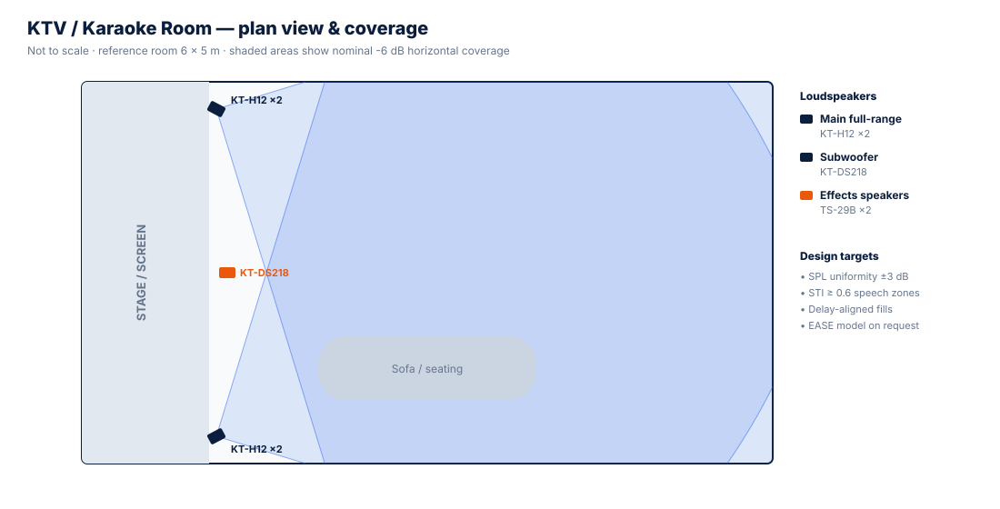

| Stage | Equipment | itc model |
|---|---|---|
| Source | Wireless mics | T-592US ×2 |
| Source | KTV player | Song system |
| Source | BGM | Line input |
| Mix | KTV processor / amplifier | T-2350KS |
| Process | Built-in DSP | Reverb · echo · anti-feedback |
| Power | Power amplifier — subs | KT-P21000 |
| Loudspeakers | Main full-range | KT-H12 ×2 |
| Loudspeakers | Subwoofer | KT-DS218 |
| Loudspeakers | Effects speakers | TS-29B ×2 |

**System goals (manufacturer):**

- Enable quick adjustments of preamp processors to meet different sound reinforcement modes
- Configure compression effect based on KTV type to prevent excessive signal output from burning speaker
- Configure noise gate effect based on KTV type to filter out superfluous noise input into the audio equipment
- Employ full-range speakers to produce the best sound quality
- Offer effective howling management to prevent microphone howling
- Store various effect modes for convenient and easy recall
- Allow for pre-setting and real-time adjustment through software based on the venue’s environment and speaker positioning

## Studio Room

Reference room: 8 × 6 m

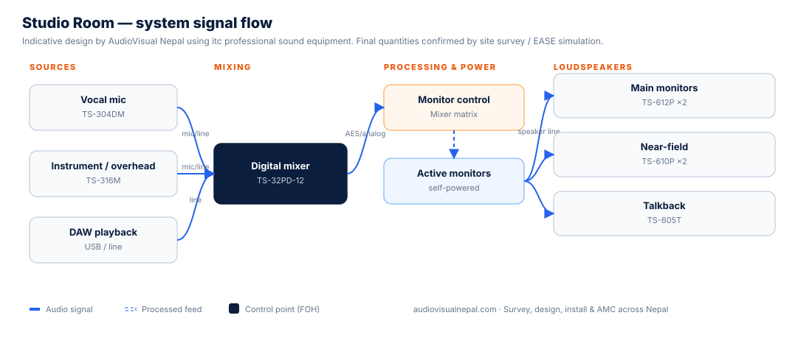

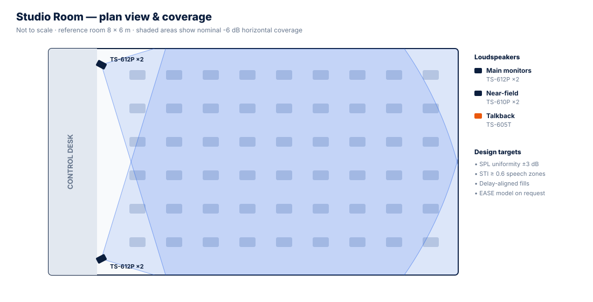

| Stage | Equipment | itc model |
|---|---|---|
| Source | Vocal mic | TS-304DM |
| Source | Instrument / overhead | TS-316M |
| Source | DAW playback | USB / line |
| Mix | Digital mixer | TS-32PD-12 |
| Process | Monitor control | Mixer matrix |
| Power | Active monitors | self-powered |
| Loudspeakers | Main monitors | TS-612P ×2 |
| Loudspeakers | Near-field | TS-610P ×2 |
| Loudspeakers | Talkback | TS-605T |

**System goals (manufacturer):**

- High-fidelity audio reproduction for recording and monitoring
- Accurate sound imaging and spatial representation
- Adaptive acoustic optimization to enhance audio precision
- High-resolution audio fidelity without distortion
- Consistent performance and reliability in demanding studio environments
- Seamless connectivity and interoperability with studio equipment and interfaces

## Theatre

Reference room: 35 × 28 m

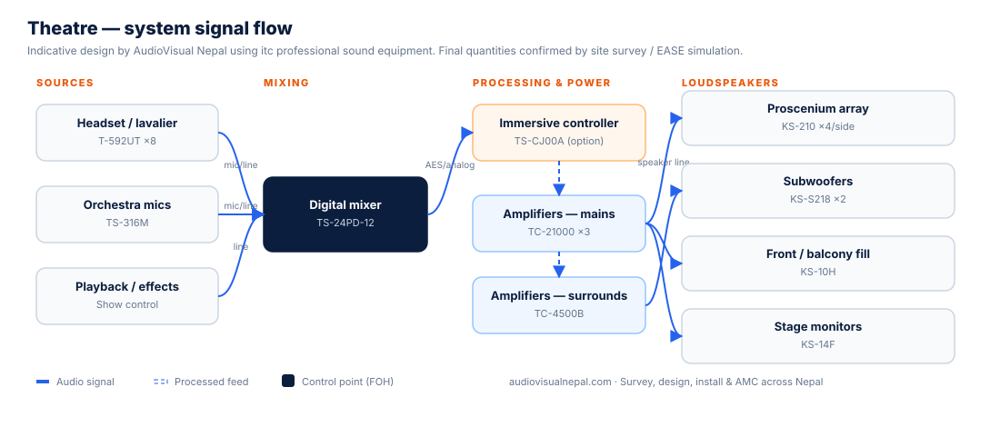

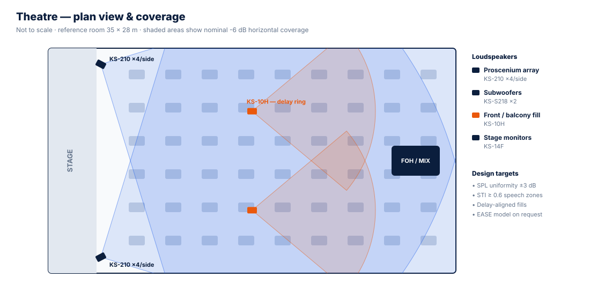

| Stage | Equipment | itc model |
|---|---|---|
| Source | Headset / lavalier | T-592UT ×8 |
| Source | Orchestra mics | TS-316M |
| Source | Playback / effects | Show control |
| Mix | Digital mixer | TS-24PD-12 |
| Process | Immersive controller | TS-CJ00A (option) |
| Power | Amplifiers — mains | TC-21000 ×3 |
| Power | Amplifiers — surrounds | TC-4500B |
| Loudspeakers | Proscenium array | KS-210 ×4/side |
| Loudspeakers | Subwoofers | KS-S218 ×2 |
| Loudspeakers | Front / balcony fill | KS-10H |
| Loudspeakers | Stage monitors | KS-14F |

**System goals (manufacturer):**

- Improve speech clarity and music intelligibility
- Extend dynamic range
- Enhance sound balance between different vocal parts (voice, music, and instrumental sound)
- Maintain appropriate integration between visual and sound
- Improve sound quality in the stage area and the auditorium
- Achieves spatial sound effects
- Modify vocals and instrument sounds

## Vocal Concert / Outdoor Show

Reference room: 60 × 40 m

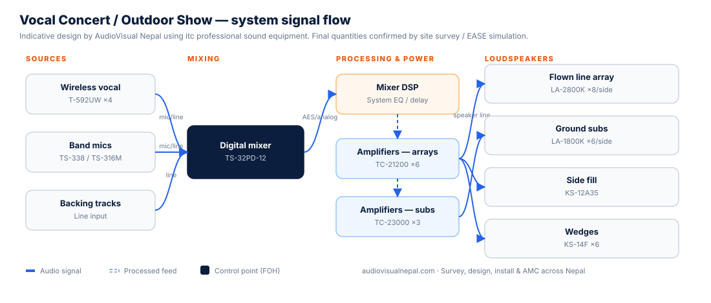

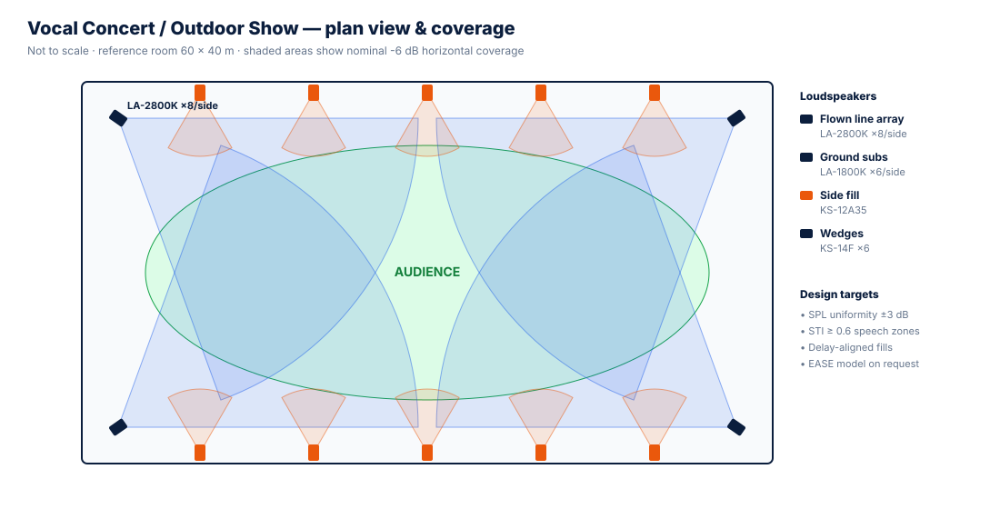

| Stage | Equipment | itc model |
|---|---|---|
| Source | Wireless vocal | T-592UW ×4 |
| Source | Band mics | TS-338 / TS-316M |
| Source | Backing tracks | Line input |
| Mix | Digital mixer | TS-32PD-12 |
| Process | Mixer DSP | System EQ / delay |
| Power | Amplifiers — arrays | TC-21200 ×6 |
| Power | Amplifiers — subs | TC-23000 ×3 |
| Loudspeakers | Flown line array | LA-2800K ×8/side |
| Loudspeakers | Ground subs | LA-1800K ×6/side |
| Loudspeakers | Side fill | KS-12A35 |
| Loudspeakers | Wedges | KS-14F ×6 |

**System goals (manufacturer):**

- Employ linear array speaker with the characteristics of uniform horizontal coverage, strong vertical directivity, and small sound energy attenuation.
- Combine with subwoofers and monitor speakers to achieve perfect sound reinforcement.
- Meet the sound pressure requirements of the venue
- With waterproof functions to ensure normal operation in bad weather
- Can be flexibly disassembled, assembled, and moved
- The system responds quickly without excessive debugging
